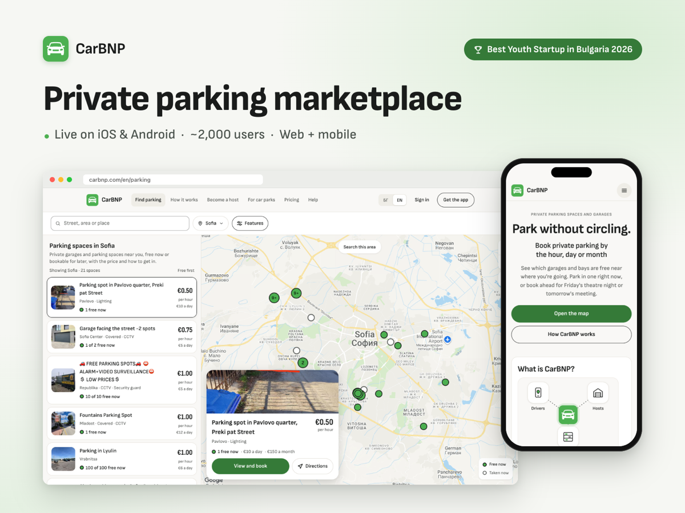

# Svetoslav Iliev

Co-founder and CTO of [CarBNP](https://carbnp.com). Full-stack and mobile developer in Sofia, Bulgaria.

I build the whole product: the React Native app, the Node.js server, the web dashboard, Stripe payments, and the ESP32 firmware when there's a device involved.

## CarBNP

CarBNP lets drivers book private parking by the hour, day or month and open the garage barrier from their phone. About 2,000 people use it, with around 400 spaces in 30 locations. In June 2026 it won 1st place in the Business Stars category of Best Youth Startup in Bulgaria, out of 330+ teams.

I wrote most of it, about 90% of the ~1,500 commits in the main repo:

- React Native (Expo) app for iOS and Android, with store releases automated through GitHub Actions, EAS and fastlane
- Node.js, TypeScript and MongoDB API with Stripe Connect payouts to space owners
- The website, the partner dashboard and the admin panel, all in React
- ESP32 firmware for the barrier controller: Bluetooth LE, commands signed by the server, over-the-air updates
- The next-generation controller board, which I'm designing now

[carbnp.com](https://carbnp.com) · [App Store](https://apps.apple.com/bg/app/carbnp/id6755657551) · [Google Play](https://play.google.com/store/apps/details?id=com.carbnpllc.carbnp)

The CarBNP code is private, so it isn't in my repo list. Most of the green squares on this page are that work.

## Selected work

| Project | What it does | My part |
|---|---|---|
| [MX Zaki booking](https://mxzaki.com) · [code](https://github.com/Svetoslav47/mxzaki-booking) | Online booking for a Sofia barbershop: pick a salon, service, barber and time; staff get an admin calendar that updates live | Sole developer. React, Express, MongoDB, Socket.IO, Google Calendar sync |
| [SimFab EU](https://simfab.eu) | E-commerce store for sim-racing equipment | Backend with the lead developer: cart and stock for bundles, Stripe and PayPal checkout, DHL/FedEx shipping quotes, SEO pre-rendering, Docker. Code is private |
| [CityTour](https://github.com/Svetoslav47/citytour) | HackYeah 2026. A walking tour guide that knows where you are and which way you're facing, and tells you about the place in front of you in English, Polish or Chinese. Native HarmonyOS app, later [ported to iOS](https://github.com/Svetoslav47/citytour-ios) with Expo | Wrote about 80% of the code, with Maria Stephanova |
| [StereoMath](https://github.com/SectorCT/StereoMath) | Take a photo of a 3D geometry problem and get a step-by-step solution plus a 3D figure you can rotate. Hack TUES X, 2nd place | Top contributor on a team of five: the React Native app and the 3D renderer |
| [WayPoint](https://github.com/SectorCT/WayPoint) | Plans daily delivery routes: clusters packages per driver with K-means, routes them with OSRM, reroutes live when a driver goes off the plan. Hack TUES 11, Bosch award | Led the React Native frontend |

| [Tuida](https://www.tuida.life) · [code](https://github.com/Svetoslav47/Tuida) | Sales site for an 18-house development by the Black Sea: interactive site map with reserved and sold houses, house pages, construction progress, gallery and a buyer contact form | Main developer, with Nikola Georgiev. React 19, TypeScript, Vite, Tailwind, Vercel |
| [Morea](https://morea-seaside.com/?lang=en) | Site for a seaside apartment building in Priboy, Varna, in Bulgarian and English | Built with Nikola Georgiev, who led it; I set up deployment |

Also built: the website for [DogTags BG](https://dogtag.bg), and SimplyForm, a form-to-email service used by client sites (private).

## Awards

- **Best Youth Startup in Bulgaria 2026**, 1st place in Business Stars, with CarBNP
- **National IT Olympiad (NOIT) 2026**, laureate, 4th nationally (grades 11–12); CarBNP 3rd in Distributed Applications
- **TUES Fest 2026**, 1st place in the Software category, with CarBNP
- **HackYeah 2025**, 3rd place, Defence category (QuantumColab)
- **Hack TUES**: 2nd overall at Hack TUES X (StereoMath), Bosch award at Hack TUES 11 (WayPoint), Technical University of Sofia award at Hack TUES 12 (Qlean), 4th overall and Best Presentation at Hack TUES 8

## Stack

- **Mobile:** React Native, Expo, EAS, fastlane, App Store Connect, Google Play Console
- **Web:** React, TypeScript, Vite
- **Backend:** Node.js, Express, MongoDB, PostgreSQL, Django, Stripe and Stripe Connect, AWS S3, Docker, GitHub Actions
- **Hardware:** ESP32 (C++), Bluetooth LE, OTA updates, KiCad for the board I'm designing

Reach me on [LinkedIn](https://www.linkedin.com/in/iliev-svetoslav/).
